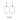
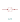
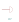
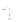
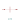
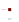
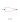
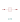
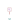
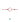

# P&ID symbol gallery

## annotation

### Interface Boundary

### Line Number Tag

### Line Type Legend

### Off-Sheet Connector - In

### Off-Sheet Connector - Out

### Umbilical

## burst-disks

### Burst Disk - Pressure

### Burst Disk - Vacuum

## engines

### Cooling Jacket

### Engine - Bipropellant

### Engine - Hybrid

### Engine - Solid

### Igniter - Pyrotechnic

### Igniter - Torch

### Injector

## equipment

### Flame Arrestor

### Gas Booster

### Heat Exchanger - Coil

### Heat Exchanger - Shell and Tube

### Vacuum Pump

## filters

### Filter - Conical

### Filter

## fittings

### Blind Flange

### Bulkhead

### Cap

### Cross

### Elbow

### Flange

### Flexible Hose

### Plug

### Reducer

### Tee

### Union

## instruments

### Coriolis Flow Meter

### Differential Pressure Indicator

### Differential Pressure Transmitter

### Flow Element - Orifice Plate

### Flow Element - Turbine

### Flow Element - Venturi

### Flow Indicator

### Flow Transmitter

### Level Indicator

### Level Transmitter

### Load Cell

### Oxygen Detector

### Pressure Indicator

### Pressure Switch

### Pressure Transducer

### RTD

### Temperature Indicator

### Temperature Switch

### Temperature Transmitter

### Thermocouple

## pumps

### Pump

## pyrotechnics

### Pyro Valve NC

### Pyro Valve NO

### Squib

## quick-disconnects

### Quick Disconnect - Both Sealed

### Quick Disconnect - Destination Sealed

### Quick Disconnect - No Sealing

### Quick Disconnect - Source Sealed

## regulators

### Back Pressure Regulator

### Pressure Regulator

## restrictions

### Cavitating Venturi

### Restriction Orifice

## valves

### Valve - 3 Way Ball Pneumatic

### Valve - 3 Way Ball Servo

### Valve - 3 Way Ball Solenoid

### Valve - 3 Way Ball

### Valve - 3 Way Globe Pneumatic

### Valve - 3 Way Globe Servo

### Valve - 3 Way Globe Solenoid

### Valve - 3 Way Globe

### Valve - 3 Way

### Valve - 4 Way

### Valve - Angle Ball Pneumatic

### Valve - Angle Ball Servo

### Valve - Angle Ball Solenoid

### Valve - Angle Ball

### Valve - Angle Globe Pneumatic

### Valve - Angle Globe Servo

### Valve - Angle Globe Solenoid

### Valve - Angle Globe

### Valve - Ball Hydraulic

### Valve - Ball Manual

### Valve - Ball Pneumatic

### Valve - Ball Servo

### Valve - Ball Solenoid

### Valve - Ball

### Valve - Butterfly Hydraulic

### Valve - Butterfly Manual

### Valve - Butterfly Pneumatic

### Valve - Butterfly Servo

### Valve - Butterfly Solenoid

### Valve - Butterfly

### Valve - Check

### Valve - Diaphragm Hydraulic

### Valve - Diaphragm Manual

### Valve - Diaphragm Pneumatic

### Valve - Diaphragm Servo

### Valve - Diaphragm Solenoid

### Valve - Diaphragm

### Valve - Gate Hydraulic

### Valve - Gate Manual

### Valve - Gate Pneumatic

### Valve - Gate Servo

### Valve - Gate Solenoid

### Valve - Gate

### Valve - Globe Hydraulic

### Valve - Globe Manual

### Valve - Globe Pneumatic

### Valve - Globe Servo

### Valve - Globe Solenoid

### Valve - Globe

### Valve - Needle Hydraulic

### Valve - Needle Manual

### Valve - Needle Pneumatic

### Valve - Needle Servo

### Valve - Needle Solenoid

### Valve - Needle

### Valve - Pressure Relief

### Valve - Pressure and Vacuum Relief

## vents

### Vent - Covered

### Vent - Uncovered

## vessels

### Bottle - 10 L - Dip Tube

### Bottle - 10 L

### Bottle - 2 L - Dip Tube

### Bottle - 2 L

### Bottle - 20 L - Dip Tube

### Bottle - 20 L

### Bottle - 50 L - Dip Tube

### Bottle - 50 L

### COPV

### Dewar

### Sample Cylinder - Large - Outage Tube

### Sample Cylinder - Large - Single-Ended

### Sample Cylinder - Large

### Sample Cylinder - Medium - Outage Tube

### Sample Cylinder - Medium - Single-Ended

### Sample Cylinder - Medium

### Sample Cylinder - Small - Outage Tube

### Sample Cylinder - Small - Single-Ended

### Sample Cylinder - Small

### Tank - Horizontal

### Tank - Large - Dip Tube

### Tank - Large

### Tank - Medium - Dip Tube

### Tank - Medium

### Tank - Small - Dip Tube

### Tank - Small

### Tank - Sphere

